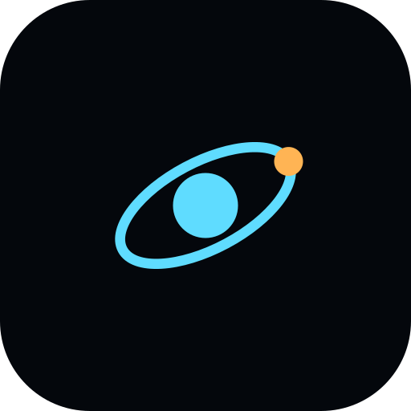
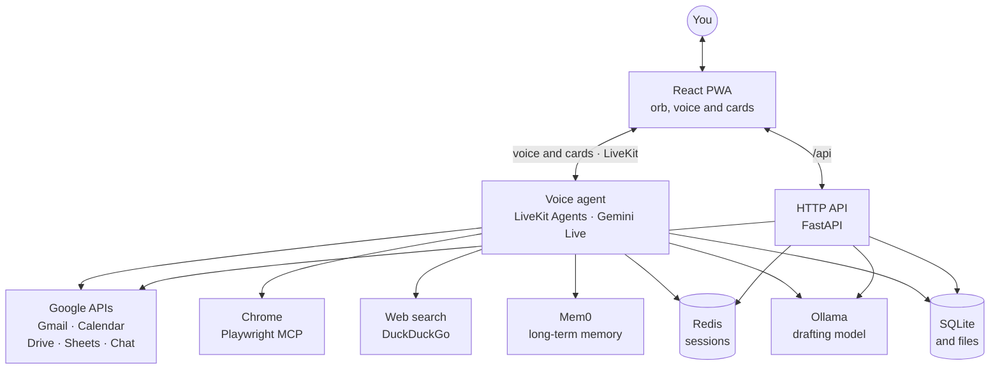

<div align="center">



# Orbit

**A voice-first personal assistant built with LiveKit, Gemini, and a React PWA.**

[](https://www.python.org)
[](https://docs.livekit.io/agents/)
[](https://ai.google.dev/gemini-api/docs/live)
[](https://fastapi.tiangolo.com)
[](https://react.dev)
[](https://www.typescriptlang.org)
[](https://vite.dev)
[](frontend/README.md)
<br>
[](#google-services)
[](https://github.com/microsoft/playwright-mcp)
[](https://mem0.ai)
[](https://redis.io)
[](https://ollama.com)
[](https://sqlite.org)
<br>
[](https://github.com/astral-sh/uv)
[](https://github.com/astral-sh/ruff)
[](backend/tests)
[](https://github.com/nk-droid/orbit/commits)

[Features](#features) · [How it works](#how-it-works) · [Getting started](#getting-started) ·
[Integrations](#integrations) · [Configuration](#configuration) ·
[Deployment and data](#deployment-and-data)


**[▶ Watch the full demo](docs/orbit-demo.mp4)**, with sound: every feature in under five
minutes, with made-up data.

</div>

Talk to Orbit to manage email, check your calendar, work with Google Drive and Sheets,
search the web, and set reminders. Results, files, and drafts appear as cards alongside
the conversation.

> [!NOTE]
> Orbit currently runs as a local application. The API does not include authentication;
> see [Deployment and data](#deployment-and-data) before exposing it to a network.

## Features

- 🎙️ **Voice conversations:** real-time audio, interruptible responses, standby mode, and
  an optional wake word using the browser's local speech recognition.
- 📬 **Google services:** read Gmail, Calendar, Chat, Drive, and Sheets. Draft emails,
  create events and documents, respond to invitations, and update spreadsheets.
- 📎 **Files and attachments:** preview Drive files and email attachments, upload local
  files, and attach files to emails. Save drafts to Gmail to finish editing there.
- 📊 **Charts:** chart a spreadsheet, your calendar, email, reminders, a CSV file, or any
  numbers in the conversation, such as prices Orbit read on a web page. Charts are saved in
  Google Sheets and pulled from there when you ask again.
- 🧠 **Memory:** retain conversation history within a browser session using Redis and
  remember preferences across sessions using Mem0.
- 🔁 **Workflows:** save a task as a workflow after doing it once, then repeat it in one step
  with what you ask for that time.
- 💼 **Job applications:** build a profile from your résumé and your own pages, search
  companies' job boards, Google, LinkedIn and Cutshort in your browser, review the jobs
  found in a Google Sheet, and apply to one job at a time. Orbit drafts and checks each
  application, fills it in after your yes, and submits it after a second yes.
- 🌐 **Browser automation:** navigate pages, manage tabs, and fill forms through Chrome
  and Playwright MCP, with visible or headless browsers.
- 🖥️ **Screen understanding:** capture a screen or named window on request and ask
  follow-up questions about it. Requires macOS.
- ⏰ **Reminders and search:** manage local reminders with browser notifications and
  search the web without a search API key.

> [!IMPORTANT]
> Google actions requested by voice are drafted and read back before execution. A code-level
> approval gate requires confirmation in a later turn. Suggested email replies can also be
> reviewed, edited, and sent from their cards.

## How it works



You talk to the voice agent through LiveKit, which carries your voice both ways and the
cards Orbit shows. The cards load and act through the HTTP API. Both work from one local
database.

## Getting started

### Prerequisites

- Python 3.12 and `uv`.
- Node.js 22.12+ and npm.
- A LiveKit Cloud project.
- A Google API key with access to the Gemini models configured in
  [the voice agent](backend/src/agent.py).

Additional services are needed for their respective features:

| Feature | Requirement |
| --- | --- |
| Google services | A Google Cloud OAuth client and the relevant APIs enabled |
| Long-term memory | A Mem0 account and `MEM0_API_KEY` |
| Session history across standby and reloads | A running Redis server |
| Suggested email replies | Ollama, signed in with access to the drafting model, or `OLLAMA_API_KEY` |
| Browser automation | Google Chrome; `npx` downloads the Playwright MCP server on first use |
| Screenshots | macOS with Screen Recording permission for the application running the backend |

Orbit can start without Mem0, Redis, or Ollama, but the corresponding features will be
unavailable.

### Configure and install

From the repository root:

```sh
cp backend/.env.example backend/.env.local
```

Set these values in `backend/.env.local`:

```dotenv
LIVEKIT_URL=wss://your-project.livekit.cloud
LIVEKIT_API_KEY=your-livekit-api-key
LIVEKIT_API_SECRET=your-livekit-api-secret
GOOGLE_API_KEY=your-google-api-key
```

Add `MEM0_API_KEY` if you want long-term memory. See
[Integrations](#integrations) for the other services.

Install dependencies:

```sh
(cd backend && uv sync)
(cd frontend && npm ci)
```

### Start the application

Run each process in a separate terminal, starting from the repository root.

**Voice agent**

```sh
cd backend
uv run python src/agent.py dev
```

**HTTP API**

```sh
cd backend
uv run uvicorn api.app:app --reload --port 8000
```

**Frontend**

```sh
cd frontend
npm run dev
```

Open [localhost:5173](http://localhost:5173), press the orb, and allow microphone access.
The Vite development server proxies `/api` requests to the backend on port 8000.

To preview the installable PWA, run `npm run build` followed by `npm run preview` in
`frontend/`, then open [localhost:4173](http://localhost:4173). The service worker is active
in the production build only.

## Integrations

### Google services

1. Enable the Google APIs you intend to use: Gmail, Calendar, Chat, Drive, and Sheets.
   Enable the Google Docs API to append text to documents created by Orbit.
2. Configure the OAuth consent screen and create an OAuth client of type **Desktop app**.
3. Save the client JSON as `backend/.secrets/google-oauth-client.json`.
4. From `backend/`, connect your account:

   ```sh
   uv run python -m integrations.google connect
   ```

The default connection requests read-only access. To enable sending email, creating
events and documents, and changing spreadsheets, request write access:

```sh
uv run python -m integrations.google connect --write
```

Check the connection from the same directory:

```sh
uv run python -m integrations.google status
```

To revoke access and remove the saved tokens, run
`uv run python -m integrations.google disconnect`.

Tokens are stored in `backend/.secrets/google-token.json`. Both the client file and tokens
are ignored by Git.

Drive writes are limited to files Orbit creates. Sheets write access covers all spreadsheets
the connected account can edit. Cell updates and row deletions require the sheet to have
been read in the current conversation, and execution checks that the affected values still
match the draft.

Sheets supports reading tabs, appending rows, updating cells, deleting rows, creating
spreadsheets, and adding charts in new tabs. Formatting, sorting, filtering, sharing, and
adding tabs for anything else are not supported.
Google Chat currently supports reading conversations; posting messages is not implemented.

### Charts

Ask Orbit for a chart or a graph of a spreadsheet tab read in the conversation, calendar
events in a date range, email matching a Gmail search, your reminders, or a CSV or TSV file
from Drive or your computer. It can also chart any numbers in the conversation: ones you
say, or ones a tool returned, such as prices on a web page the browser read or figures in a
search result. Orbit draws bar, horizontal bar, stacked bar, 100% stacked bar, line, area,
stacked area, pie, donut, scatter, and histogram charts. The backend works out every
number from the data and the app draws the chart. A chart's card can also show its
numbers as a table.

<details>
<summary><b>Levels, checked values, saving and limits</b></summary>

Values can also be levels in words, such as "5y+", "Academic" or "Expert". These are drawn
as bars or a line on an ordered scale with each level named. Levels with a number in them
are ordered by it, and familiar words such as Beginner and Expert by their usual order. You
can ask for another order.

A value taken from the conversation is checked against its source, so the model cannot
make it up or move it to another label. A number you said can be anywhere in what you
said. A value a tool returned must be given for its own label: on that label's row of a
page, or within a sentence or two of it, and not merely sent to the tool by Orbit. When you
ask for all of something on a page, such as "all the skills", every row of that list has to
be in the chart. Each value keeps the currency it was shown with, and the chart is
labelled with where it came from, such as the website.

Charts are saved in Google Sheets. The first time, Orbit asks before creating a spreadsheet
named **Orbit charts** in your Drive. After that, each new chart goes into it without
asking, as a tab with the chart's numbers and a Sheets chart. Ask for a chart again, by its
name or by asking for the same thing, and Orbit pulls it from its tab instead of making a
new one. Orbit can redraw a saved chart as another kind, such as a bar chart as a pie, or
read its numbers again from the source when you ask for fresh ones; either way its tab is
updated in place. A chart of numbers from a conversation is updated with new ones Orbit
finds, such as the same page read again. A chart whose tab was deleted is made again. If
Google cannot be reached, the chart is shown without being saved and Orbit says why. To add
a chart to one of your own spreadsheets, Orbit drafts it in a new tab for your approval.
Saving needs write access (`connect --write`) and the Google Sheets API enabled.

Large data is reduced visibly, never silently. Bar charts with more than 12 labels are drawn
sideways, with a line for each label, and keep up to 100 labels. Past that, and past 7
slices of a pie or 30 labels of a line, the largest are kept and the rest are added
together under Other. Up to 8 series are drawn. Values that cannot be added together, such
as averages or levels, keep the largest and leave the rest out. Charts read up to 2,500
calendar events or 500 emails, and a scatter chart draws up to 2,000 points, taken evenly.
The card notes anything grouped or left out. A count in which every label comes once is
refused, since each bar would be 1.

</details>

### Job applications

Ask Orbit to help you find and apply for jobs. It works in a copy of one of your Chrome
profiles, which you name, so it can read pages that need you signed in.

<details>
<summary><b>Your profile, résumés, searching, Orbit jobs, applying and its checks</b></summary>

- **Your profile.** Orbit builds it from your résumés (PDFs you hand over, or the one your
  portfolio links to), your portfolio, GitHub and LinkedIn, and what it remembers about
  you. The drafting model reads them, and a value is kept only if its source says it in the
  words quoted; contact details and links must be there as written. Where sources disagree,
  the Profile card shows each, and you choose by voice. You change any field by voice.
- **Résumés.** Keep one for each kind of role you apply to, such as AI Engineer and
  Backend Developer. Each application sends the one made for the job's kind of work, as you
  said or as its file's name says (resume-backend.pdf is for backend roles), and otherwise
  the one whose own words, such as Kafka or PyTorch, the posting asks for most. The draft
  names it and why; say "send my AI résumé instead" and what it wrote is drafted again
  from that one.
- **Searching.** Orbit searches companies' own job boards first, on Greenhouse, Lever and
  Ashby, every page of each: those of companies you name ("watch Razorpay and Zerodha"),
  those in your profile's companies to seek, and those of companies it comes across, whose
  boards it finds once and remembers. Then it searches Google, in your own browser, with
  Google's advanced search: each of your roles and the titles that mean the same, joined by
  OR, your top skills, your place, `after:` the earliest date you want, and `-intitle:`
  for internships and courses. One search looks at companies' boards on those systems
  (`site:`), and one at companies' own careers pages anywhere (`inurl:careers`), leaving
  out job sites such as LinkedIn and Naukri (`-site:`). Then it searches LinkedIn Jobs,
  one page at a time, reading each card as it scrolls by, since LinkedIn shows only the
  cards in view, and Cutshort, which lists jobs by field and city rather than by
  title (AI Engineer and LLM Engineer are both its AI jobs, searched once) and shows a
  search its newest 50. A place is a city, remote, or all of India, such as "Anywhere in
  India", which searches the whole country and keeps remote jobs open to India too; a
  place in any other country is not one of yours. Only listings for one of your roles, in
  one of your places, at your level and not asking for more than two years beyond your
  experience are opened, and every one of them is: a search goes on until it has found
  250 jobs, and the next search goes on past them. Each posting is read once its page
  has stopped changing, scrolled through, as LinkedIn and Naukri fill theirs in after
  they open; one that still shows nothing is not judged. The drafting model judges each,
  and only good fits are kept, shown by the posting's own words, not just its title and
  place. The board of every company a job was kept at is searched after, for its other
  openings. A job found both on a company's board and on LinkedIn is kept
  once, with the company's own posting. Jobs you have applied to are left out: those
  Orbit sent, and those a site you are signed in to marks as applied, as LinkedIn does.
  A job that can be applied to only on LinkedIn (Easy Apply) or on Naukri is kept, to
  apply to there, when its company's own page does not list it: when the company's
  board does, the job is applied to on the company's page instead. Say so to leave such
  jobs out. Every Cutshort job applies on Cutshort, so searching it keeps its jobs,
  unticked, for you to choose. How many results pages, how recent, and how many applications at a sitting are
  settings you change by voice. Naukri is searched too when you add it; it refuses
  headless browsers.
- **Orbit jobs.** The jobs found go into a Google Sheet that Orbit makes in your Drive with
  your yes, each with where it is, the years of experience it asks for, when it was
  posted and its pay: as the posting says them, in its words or in the JobPosting data
  pages keep for search engines, or else as its listing's card does. You tick or untick
  each job's Apply box and add notes there or by voice, and Orbit reads your changes back
  before it applies to anything. A Searches tab records what
  each search kept and left out, and why, and an Applications tab what was sent.
- **Applying.** For each ticked job, Orbit opens the application on the company's own
  site (Greenhouse, Lever, Ashby or a careers page), reads the form, and drafts every
  answer: profile fields from your profile, choices matched to the form's options, and
  written answers and a cover letter from the drafting model. A form that takes the letter
  as a file, or has nowhere for it but a field for any document, such as "Add attachment",
  gets it as a PDF. The draft appears as a card
  listing every answer and where it came from. Your first yes fills the form in, in the
  browser; the page is read back and compared with the draft. Your second yes submits it,
  once the page still holds what you approved. A field you changed by hand is shown to
  you before anything is sent. A form over several steps is drafted and filled in a step
  at a time; Next sends nothing. LinkedIn's Easy Apply form is drafted and filled in like
  any other. Naukri's own Apply sends your Naukri profile in one press, with nothing to
  fill in, so it comes as a single draft and Orbit presses Apply only on your yes;
  questions the recruiter asks after that are yours to answer in the browser. Cutshort's
  own application is used only when you say so; on a Cutshort posting Orbit presses only
  its "Apply to this job", never the "Apply now" of the similar jobs listed beside it.
- **Finding the form.** A page may build its form a moment after it loads, so Orbit
  gives it a few seconds. When it still finds none, it looks at a screenshot of the page,
  read by the vision model: a form still loading is waited for, a button that opens the
  application is pressed (never one that sends it), a sign-in or a check that you are a
  person is handed to you, and otherwise you are told what the page shows. Say the
  application is open in the browser and Orbit reads it there, in whichever tab, instead
  of opening the job again.
- **Checks.** Before filling in and again before submitting, code checks that every
  required field has an answer, contact details match your profile and are well formed,
  the company is spelled as the posting spells it and no other company is named, and
  answers are within their limits, free of placeholders and Markdown, and in the form each
  field takes. A cover letter must greet and sign off with your name. The drafting model
  also proofreads what it wrote and flags any claim your profile and résumé do not support.
- **Always yours.** Consents, salary, and personal questions such as gender or veteran
  status are never answered from a guess: Orbit asks, or leaves an optional one blank, and
  can keep your answer for the next form. Sign-ins, account creation and checks that you
  are a person, such as a CAPTCHA, are handed to you in the browser. Orbit tells you, offers
  to show the browser if it is hidden, watches the page, and carries on by itself once you
  have done it, for up to ten minutes. A check on a form is done before you say to submit;
  one that comes up after Submit is watched until the application goes through. Orbit
  never does such a check itself or tries to get around one.

</details>

Applying needs Orbit jobs, so Google write access (`connect --write`) and the Google Sheets
API enabled, and the drafting model (see [Suggested email replies](#suggested-email-replies)).
With `ORBIT_DRY_RUN` set, everything is done except the click on Submit.

> [!WARNING]
> Job sites' terms often forbid automated use, LinkedIn's among them, and Orbit works in
> your own signed-in profile: it reads one page at a time and applies only with your
> approval, but the risk to your account is yours to weigh.

### Memory

- **Long-term memory:** set `MEM0_API_KEY` in `backend/.env.local`. Orbit uses Mem0's hosted
  MCP server to save, find, update, and forget memories across conversations. Memories can
  also be managed in the Mem0 dashboard.
- **Workflows:** after a browser task, or after Orbit sends or creates something for a
  request that mentions something of yours, such as "my test email", Orbit offers to
  remember how the task was done. It saves the workflow only if you agree. A workflow keeps
  its steps and the values you call yours. Anything you say anew each time, such as a song
  or a message, comes from your request whenever the workflow runs. A browser workflow
  reopens the browser as before, shown or hidden and on the same profile, without asking.
  Ask Orbit to forget a workflow to remove it. Workflows are stored locally.
- **Session memory:** start Redis and set `REDIS_URL` if it differs from
  `redis://localhost:6379/0`. Check the connection with `redis-cli ping`. History survives
  standby and reloads within a tab; a new tab starts a separate session. History expires
  shortly after the tab closes, or after 15 minutes without a heartbeat.

### Suggested email replies

Run Ollama and sign in with `ollama signin`. The default drafting model is
`gpt-oss:120b-cloud`. Alternatively, set `OLLAMA_API_KEY` to call Ollama's cloud directly;
that connection defaults to `gpt-oss:120b`.

Use `OLLAMA_HOST` to change the local endpoint or `ORBIT_DRAFT_MODEL` to choose another
model. With the default models, email content is processed in Ollama's cloud even when
accessed through the local Ollama application. Replies wait for review and a press of Send.

### Browser and screenshots

Browser automation requires Chrome on the backend host. Orbit asks whether to show or
hide the browser before first use. Visible browsers remain open in standby and can be
reused in the next conversation; headless browsers close when the conversation ends.

A page's snapshot, which Orbit uses to click and type, is cut short after 5,000 characters.
When Orbit needs all of something on a page, such as every item of a list, it reads the
page whole as text instead, up to 20,000 characters, with each list item and table row on
one line.

Orbit can open addresses on your computer or local network, such as an app at
`http://localhost:3000`. It works out the address from what you ask, such as "my app on
port 3000" or "the app I'm running locally". If nothing answers there, it looks for apps on
the usual ports. When your request is not about something on your computer, Orbit asks
before opening a local address, so a web page cannot send the browser there. Orbit's own
app and API are never opened in the browser.

When a page asks for a check that you are a person, such as a CAPTCHA or a security check,
Orbit leaves it to you: it says so, offers to show the browser if it is hidden, and goes on
once you have done it. It never clicks or solves the check itself.

Browsers use a temporary, signed-out profile unless you explicitly name one of your Chrome
profiles. Named profiles are copied for the browser and the copy is deleted when the browser
closes. On macOS, accessing Chrome profiles may require Full Disk Access for the application
running the backend. A copied profile retains signed-in sessions, so close it when finished.

Screenshots work only on macOS and capture the computer running the backend. Enable Screen
Recording for its terminal or editor under **System Settings > Privacy & Security**.
Orbit captures only when requested and sends the image to Gemini for analysis. Images are
held for follow-up questions during the conversation; temporary capture files are deleted.

## Configuration

See [backend/.env.example](backend/.env.example) and
[frontend/.env.example](frontend/.env.example) for the available settings. Backend values
belong in `backend/.env.local`; frontend values belong in `frontend/.env.local`.

| Variable | Purpose |
| --- | --- |
| `ORBIT_SILENCE_SECONDS` | Silence before Orbit responds; defaults to `1.5` seconds |
| `ORBIT_VISION_MODEL` | Gemini model used to interpret screenshots |
| `ORBIT_SEARCH_BACKEND` | Search engine selection; `auto` enables fallback engines |
| `ORBIT_DRY_RUN` | Set to `1` to simulate approved Google actions without executing them, and to stop job applications short of Submit |
| `ORBIT_DATA_DIR` | Override the local data directory |
| `ORBIT_SECRETS_DIR` | Override the OAuth credentials directory |
| `ORBIT_CHROME_USER_DATA` | Override Chrome's profile directory |
| `ORBIT_ALLOWED_ORIGINS` | Comma-separated origins accepted by the API's CORS policy |
| `VITE_API_BASE_URL` | Frontend API base URL when hosted separately from the backend |
| `VITE_WAKE_WORD` | Set to `off` to disable wake-word listening in standby |

The wake word requires browser support for on-device speech recognition and microphone
permission. Pressing the orb remains available when local recognition is unsupported.

## Repository structure

| Path | Purpose |
| --- | --- |
| `backend/src/agent.py` | LiveKit voice agent and Gemini configuration |
| `backend/src/agent_tools/` | Voice tools for Google services, memory, browser, screen, and cards |
| `backend/src/api/` | FastAPI routes used by the frontend |
| `backend/src/integrations/` | Google OAuth, service clients, and web search |
| `backend/src/actions/` | Draft storage, approval gate, and action execution |
| `backend/src/charts/` | Chart data sources, the numbers each chart draws, and saving to Sheets |
| `backend/src/jobs/` | Job profile, searches, Orbit jobs, application forms and their checks |
| `backend/src/drafting/` | Email triage and suggested replies |
| `backend/tests/` | Unit tests and model integration tests |
| `frontend/src/voice/` | LiveKit connection, microphone, and wake word |
| `frontend/src/stage/` | Card layout and window management |
| `frontend/src/cards/` | Cards for results, drafts, files, and reminders |
| `frontend/src/charts/` | Charts drawn as SVG from the numbers the backend works out |

The frontend communicates with the backend over `/api` and with the voice agent over
LiveKit. See the [frontend README](frontend/README.md) for UI structure and build commands.

## Deployment and data

> [!CAUTION]
> Orbit is intended for local development and personal use in its current form.

- **Authentication:** API routes are unauthenticated, including session token issuance,
  email, spreadsheet, and upload endpoints. Keep the API bound to localhost until
  authentication and authorization are added. CORS configuration does not provide access
  control.
- **Hosting:** microphone access requires HTTPS or localhost. If the frontend and API use
  different origins, configure `ORBIT_ALLOWED_ORIGINS` and `VITE_API_BASE_URL`.
- **Cloud processing:** voice conversations and screenshot analysis use Gemini through
  Google's APIs; voice transport uses LiveKit. Long-term memories are stored in Mem0,
  and the default email drafting models use Ollama's cloud. For job applications, the
  drafting model is also given your résumé, profile and the postings Orbit reads.
- **Local storage:** reminders, saved workflows, saved charts, action history, reply
  drafts, and your job profile, résumé, jobs and applications live under
  `backend/.data/`.
  Attachment copies are stored temporarily there. Session transcripts live in Redis and
  may also be written to disk if Redis persistence is enabled. Environment files,
  `.secrets/`, and `.data/` are ignored by Git.
- **Browser actions:** job applications are filled in and submitted only through the
  approval gate, with a yes for each. Confirmation before submitting other forms or
  changing accounts relies on model instructions.
- **Current limits:** reminders notify only while the app is open. File previews are
  limited to 50 MB; email attachments to 25 MB total. Live-service and physical-device
  verification is incomplete; many integration tests use mocked services.
